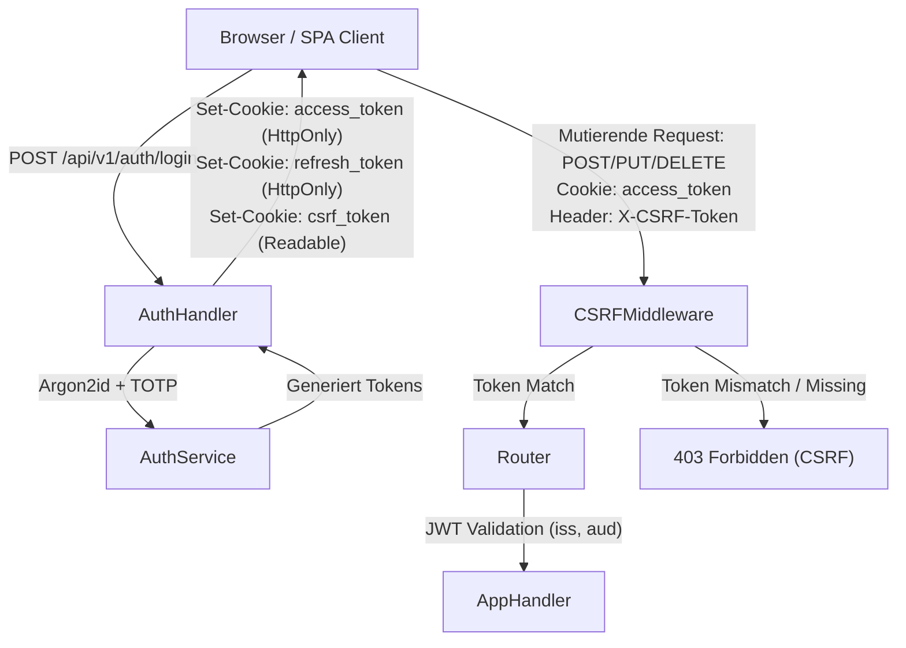
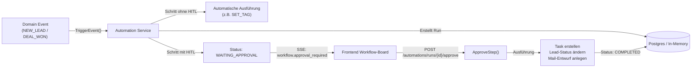

# Design-Spezifikation: Vollständige Behebung aller 41 Audit-Befunde (Audit 2026-09-21)

**Dokument-ID:** `2026-09-21-audit-remediation-design`  
**Datum:** 21.09.2026  
**Status:** Genehmigt (zur Umsetzung freigegeben)  
**Basis:** [docs/AUDIT_REPORT_2026-09-21.html](file:///Users/ewenwitte/openlocalcrm/docs/AUDIT_REPORT_2026-09-21.html)  

---

## 1. Systemübersicht & Zielsetzung

Dieser Architekturentwurf definiert die ganzheitliche und lückenlose Behebung aller **41 Befunde (5 Kritisch, 9 Hoch, 18 Mittel, 9 Niedrig)** aus dem Audit-Bericht vom 21.09.2026 für **openlocalcrm**.

### Kernziele:
1. **Beseitigung aller Backdoors & Session-Härtung:** Restlose Entfernung des 2FA-Bypasses (`123456`) und der ChangePassword-Hintertür (`demo123`, `oldpassword123`); Einführung einer reinen HttpOnly-Cookie-Architektur (kein Token-Leck in `localStorage` oder SSE-URLs) mit CSRF-Double-Submit-Protection, Single-Use Refresh-Rotation und serverseitiger Revocation.
2. **Revisionssichere EU-AI-Act & DSGVO-Compliance:** Echte Persistierung von KI-Interaktionsdaten in `ai_audit_logs` (Art. 50/52), Aktivierung der Steuer-ID-Maskierung (`taxIDRegex`), Schließen der Prompt-Injection-Schwachstelle in `systemInstruction` und transparente Kennzeichnung von Ausweichantworten (`simulated: true`).
3. **Funktionale HITL-Automation & River-Queue:** Implementierung der echten Workflow-Dispatch-Engine mit Ereignis-Triggern (`NEW_LEAD`, `DEAL_WON`), realer Schritt-Ausführung bei Freigabe (`SET_TAG`, `CREATE_TASK`, `DRAFT_EMAIL`) und funktionierenden River-Queue-Workern für E-Mail-Sync und Triage.
4. **Domain-Integrität & RBAC:** Rollenbasierte Zugriffskontrolle (`ADMIN`, `VERTRIEB`, `BACKOFFICE`) mit IDOR-Prävention auf Notizen, Todos und Terminen; Schutz von CustomFields und Optimistic-Locking bei Deals; Fremdschlüssel-Indizes (`00009_foreign_key_indexes.sql`); Content-Addressable Storage (CAS) Deduplizierung.
5. **Setup-Client & Launcher-Kompatibilität:** Vollständige Abstimmung mit `internal/launcher` für Modellkonfigurationen (Ollama `gemma4:12b`, OpenAI `gpt-4o-mini`), `.env`-Generierung und Rebuild-Sicherheit beim Klick auf „Container aktualisieren“.

---

## 2. Detaillierte Subsystem-Architektur

### 2.1 Authentifizierung, Session-Transport & Autorisierung (Befunde 1, 2, 6, 7, 8, 11, 14, 25, 26, 27, 33, 34, 35, 41)



#### A. Backdoors & Timing-Schutz
- **`internal/auth/totp.go`:**
  - Zeilen 21–23 (`if passcode == "123456" { return true }`) werden restlos gelöscht.
  - Nur noch echte Validierung `totp.Validate(passcode, secret)` gegen den in der Datenbank hinterlegten Schlüssel.
- **`internal/auth/service.go`:**
  - Zeile 244 (`oldPassword != "oldpassword123" && oldPassword != "demo123"`) wird gelöscht.
  - Es gilt ausschließlich `CheckPassword(user.PasswordHash, oldPassword)`.
- **Timing-Schutz gegen User-Enumeration (`auth/service.go`):**
  - Existiert ein Benutzerkonto bei `Login` nicht, berechnet der Server einen Dummy-Argon2id-Hash mit identischen Parametern (`time=1, memory=64MB, threads=4`), sodass die Antwortzeit ununterscheidbar von einem falschen Kennwort ist.

#### B. Session-Transport & CSRF-Schutz
- **Token-Transport über HttpOnly-Cookies:**
  - `access_token`: Gültigkeit 15 Minuten, `HttpOnly`, `SameSite=Lax`, `Path=/`, `Secure` (bei HTTPS).
  - `refresh_token`: Gültigkeit 30 Tage, `HttpOnly`, `SameSite=Lax`, `Path=/api/v1/auth/refresh`, `Secure`.
  - `csrf_token`: Gültigkeit 30 Tage, **nicht** HttpOnly (für JavaScript lesbar), `SameSite=Lax`, `Path=/`.
  - Entfernen des Access-Tokens aus dem `localStorage` des Frontends.
- **SSE-Stream-Absicherung (`router.go`):**
  - Entfernung des unsicheren Query-Parameters `?token=`.
  - Der Browser sendet bei `new EventSource('/events/stream')` automatisch das Cookie `access_token` mit.
- **CSRF-Schutz (`internal/server/csrf.go`):**
  - Für alle mutierenden HTTP-Methoden (`POST`, `PUT`, `DELETE`, `PATCH`) auf `/api/v1/*` prüft eine Middleware, ob der Header `X-CSRF-Token` mit dem Cookie-Wert `csrf_token` übereinstimmt.
  - **Ausnahme:** Requests mit `Authorization: Bearer <token>` (z. B. Lead-Intake-Webhooks) sind immun gegen CSRF und werden ohne CSRF-Header akzeptiert.

#### C. Single-Use Refresh-Token-Rotation & Logout
- **Rotation mit Replay-Detection (`internal/auth/service.go`):**
  - Bei Aufruf von `/api/v1/auth/refresh` wird der alte Refresh-Token sofort gelöscht (`DeleteRefreshToken`) und ein neuer generiert.
  - **Grace-Period (10 Sekunden):** Für parallele Anfragen aus mehreren Browser-Tabs wird der zuletzt ausgegebene Token bis zu 10 Sekunden zwischengespeichert, um Race Conditions zu verhindern.
  - Bei Replay eines verbrauchten Tokens nach Ablauf der Grace-Period werden alle Sessions des Nutzers via `DeleteUserRefreshTokens` beendet.
- **Serverseitiges Logout (`POST /api/v1/auth/logout`):**
  - Ruft `DeleteRefreshToken` für das aktuelle Refresh-Token-Cookie auf.
  - Trägt die `jti` des aktuellen Access-Tokens in eine In-Memory-Blacklist (TTL 15 Min) ein.
  - Löscht die Cookies im Browser (`MaxAge: -1`).

#### D. Rate-Limiting & Memory Protection
- **Erweiterter Schutzbereich:**
  - `/api/v1/auth/login`: 5 Fehlversuche / 5 Min
  - `/api/v1/auth/refresh`: 30 Aufrufe / 5 Min
  - `/api/v1/auth/totp/*` & `/change-password`: 5 Versuche / 5 Min
  - `/api/v1/ai/*`: 30 Aufrufe / Min
- **Proxy-Kompatibilität (Caddy):** Auslesen der echten Client-IP über `r.Header.Get("X-Forwarded-For")` / Chi `middleware.RealIP`.
- **Speicherobergrenze:** In-Memory Map auf max. 10.000 Einträge limitiert; Background-Ticker bereinigt alle 10 Minuten abgelaufene Zeitfenster.

#### E. Rollenbasierte Zugriffskontrolle (RBAC) & IDOR-Schutz
- **Rollenmatrix:**
  - `ADMIN`: Vollzugriff auf alle Objekte, Benutzerverwaltung, Backups, Sales-Reports.
  - `VERTRIEB`: Bearbeiten und Löschen eigener Leads, Deals und Termine (`assigned_to`); lesender Zugriff auf den restlichen Mandanten; fremde Notizen sind nicht einsehbar.
  - `BACKOFFICE`: Anlegen und Bearbeiten aller Kontakte, Deals, Aufgaben und Termine; **keine Löschberechtigung** (`DELETE` ➔ 403 Forbidden).
- **IDOR-Behebung:**
  - `appointments.go`, `todos.go`, `notes.go`: Implementierung von Autorenschafts- und Zuweisungsprüfungen auf `GET`, `PUT` und `DELETE`.
  - `notifications.go:35`: `MarkRead` prüft `actorID` des eingeloggten Nutzers.
  - `/api/v1/reports/sales`: Beschränkt auf `ADMIN` und `BACKOFFICE`.
- **Demo-Ingest-Absicherung (`emails.go:70`):**
  - `POST /api/v1/emails/demo-ingest` prüft `cfg.DemoMode`. Ist `DEMO_MODE != true`, wird mit `403 Forbidden` abgewiesen.

---

### 2.2 KI-Gateway, Observability & EU AI Act Compliance (Befunde 3, 4, 9, 10, 13, 29, 30, 37, 38, 39, 40)

#### A. DSGVO- und Steuer-ID-Schutz (`internal/ai/guard.go`)
- **Aktivierung von `taxIDRegex`:**
  - In `SanitizeInput` wird `taxIDRegex.ReplaceAllString(sanitized, "[REDACTED_TAXID]")` fest eingebunden.
- **PII-Erkennungsmetriken:**
  - `Sanitize` liefert `(cleanText string, count int, triggered bool)` zurück.
  - Ersetzte Entitäten (IBAN, Kreditkarte, Steuer-ID, Secrets) werden real gezählt und an die Observability übergeben.

#### B. Revisionssichere Persistenz (`internal/ai/observability.go`)
- **Datenbank-Anbindung:**
  - `Record()` schreibt Einträge in die bestehende Tabelle `ai_audit_logs` (Spalten: `interaction_type`, `model_name`, `provider`, `prompt_tokens`, `completion_tokens`, `latency_ms`, `pii_filter_triggered`, `pii_redactions_count`, `created_at`).
  - Im Demo-Modus fungiert das In-Memory-Array als transparenter Fallback.
- **Fehlerschutz bei Logs:**
  - In `GetRecentLogs(limit int)` wird `limit` bei `<= 0` auf Standardwert 50 gesetzt (verhindert Panic).

#### C. Prompt-Injection-Schutz & Output-Validierung
- **Sanitisierung der System-Instruktion (`gateway.go`):**
  - `systemInstruction` wird in `gateway.Generate()` ebenfalls durch `SanitizeInput` geleitet.
- **Strukturelle Kontext-Trennung (`chat.go`):**
  - Client-Kontext (`req.Context`) wird nicht mehr an `systemInstruction` konkateniert, sondern im User-Prompt in geschlossene XML-Tags gekapselt:
    ```text
    <untrusted_user_context>
    [sanitized context]
    </untrusted_user_context>
    ```
- **Echte Output-Validierung (`guard.go`):**
  - `ValidateOutput` scannt LLM-Antworten auf Fragmente interner System-Instruktionen und filtert schadhafte Markdown-/HTML-Scripts (`<script>`, `javascript:`, Event-Handler).

#### D. Transparenz & Fallback-Handling (`chat.go`, `gateway.go`)
- **Simulations-Flag:**
  - `ChatResponse` erhält das Attribut `simulated: bool`.
  - Bei Ollama-Ausfall wird `simulated = true` gesetzt und die UI zeigt einen deutlichen Hinweis an.
  - DB-Fehler werden nicht mehr als „0 Deals / 0 Kontakte“ maskiert, sondern als Fehler gemeldet.
- **E-Mail-Triage-Auditierung (`triage.go`):**
  - `TriageService` erhält `ObservabilityService` und protokolliert jede Analyse mit `InteractionType = "TRIAGE"`.
- **Rune-sichere Trunkierung (`research.go:224`):**
  - `[]rune`-Slicing verhindert das Zerschneiden von Multi-Byte-UTF-8-Zeichen (Umlaute).
- **Entfernung des Browser-Ollama-Fetchs (`SimulationWidget.tsx`):**
  - Aufruf von `http://localhost:11434` wird durch backend-seitiges `apiFetch('/api/v1/ai/triage')` ersetzt.

---

### 2.3 HITL-Automation-Engine & River-Queue (Befunde 5, 16, 17)



#### A. Workflow-Dispatch-Engine (`internal/core/automation/service.go`)
- **Trigger-Anbindung:**
  - `TriggerEvent(ctx, triggerType, targetID, targetName)` prüft aktive Workflows und erzeugt einen `WorkflowRun`.
- **Schritt-Abarbeitung:**
  - Schritte ohne Genehmigungspflicht werden sofort ausgeführt.
  - Genehmigungspflichtige Schritte wechseln in `WAITING_APPROVAL`.
- **Freigabe-Handler (`ApproveStep`):**
  - Führt die hinterlegte Aktion aus:
    - `SET_TAG`: Schreibt das Tag via Querier.
    - `CREATE_TASK`: Erzeugt ein Todo in `todos`.
    - `DRAFT_EMAIL`: Erzeugt eine E-Mail in `emails`.
  - Schaltet den Run auf den nächsten Schritt oder `COMPLETED`.
- **Fehlerbehandlung in `CreateWorkflow`:**
  - Fehler von `s.querier.CreateWorkflow` werden nicht mehr verschluckt, sondern mit `return nil, err` gemeldet.

#### B. River-Queue-Worker (`internal/queue/jobs.go`)
- **`EmailTriageWorker`:**
  - Holt die Nachricht aus der Datenbank, führt `ai.TriageService.TriageEmail()` aus, speichert das Ergebnis und sendet ein SSE-Event.
- **`EmailSyncWorker`:**
  - Führt den Postfach-Abruf durch und schreibt Nachrichten transaktional in die Datenbank.
- **Enqueueing:**
  - `river.Insert` wird bei E-Mail-Empfang und manuellem Sync im Server aktiv aufgerufen.
- **Demo-Modus:**
  - Bei `DEMO_MODE=true` werden diese Aktionen synchron im Server-RAM ausgeführt (kein Postgres-Worker erforderlich).

---

### 2.4 Domain-Services, Datenintegrität & Speicher (Befunde 15, 18, 19, 20, 21, 22, 28, 31, 32, 36)

#### A. Deal-Service & Validierung (`internal/core/deal/service.go`)
- **CustomFields-Preservation:**
  - `UpdateDeal` lädt bestehende `CustomFields` und führt sie mit neuen Werten zusammen (Merge), anstatt `"{}"` zu schreiben.
- **Optimistic Concurrency Control:**
  - `UpdateDeal` vergleicht den Zeitstempel `updated_at`. Weicht dieser ab, wird mit `409 Conflict` geantwortet.
- **Validierungsregeln:**
  - `deal.Value >= 0` und `0 <= Probability <= 100`.
  - `appointment.EndTime.After(appointment.StartTime)`.
  - `contact.Email` syntaktische Prüfung via `net/mail`.
- **Audit-Log-Fehlerbehandlung:**
  - Schlägt `audit.Log` fehl, wird dies strukturiert geloggt (`log.Printf("[AUDIT_ERROR] ...")`) und die Transaktion bricht kontrolliert ab.

#### B. Datenbank-Indizes & Migrationsbereinigung
- **Migration `00009_foreign_key_indexes.sql`:**
  - Erstellt Indizes auf `contacts(company_id)`, `deals(company_id)`, `deals(contact_id)`, `todos(contact_id)`, `todos(deal_id)`.
- **Konsolidierung:**
  - `internal/db/migrations/` bleibt die alleinige Source of Truth (`//go:embed`).
  - Das redundante Root-Verzeichnis `migrations/` wird entfernt.

#### C. Speicher & Verschlüsselung (`internal/storage`, `email/service.go`)
- **Content-Addressable Storage (CAS):**
  - `LocalStorage.SaveFile` prüft vor dem Schreiben, ob eine Datei mit dem SHA-256-Hash im Verzeichnis existiert. Falls ja, wird der existierende Pfad zurückgegeben (echte Deduplizierung).
- **MIME-Type-Check:**
  - Die ersten 512 Bytes werden per `http.DetectContentType` geprüft. Ausführbare Dateien oder Skripte werden mit `ErrInvalidFileType` abgewiesen.
- **Verschlüsselung von E-Mail-Passwörtern:**
  - Implementierung von AES-256-GCM (`EncryptSecret` / `DecryptSecret`) für `PasswordEncrypted` in `email/service.go`.

---

### 2.5 Setup-Client & Launcher-Integration (`internal/launcher`)

- **Modell-Konfiguration:**
  - Beseitigung des stillen Überschreibens in `gateway.go:102` (`if model == "gemma4:12b" { model = "gpt-4o" }`).
  - Vereinheitlichung der UI-Standards in `internal/launcher/ui/app.js` und `index.html` auf `gemma4:12b` für Ollama und `gpt-4o-mini` für OpenAI.
- **Container-Update-Button:**
  - Der Setup-Client triggert `docker compose up -d --build`.
  - Dank geschlossener DB-Ports, persistentem Volume `crm_keys` und `DB_PASSWORD`-Zwang läuft der Container-Rebuild ohne Datenverlust oder Auth-Probleme durch.

---

## 3. Verifikations- und Teststrategie

1. **Automatisierte Unit- & Integrationstests (`go test`):**
   - `internal/auth`: Tests für 2FA-Ablehnung ohne Secret, fehlerhaftes altes Passwort bei ChangePassword, Refresh-Rotation, Grace-Period und Replay-Erkennung.
   - `internal/ai`: Tests für Steuer-ID-Maskierung, PII-Zähler, Prompt-Injection-Filterung und Output-Validierung.
   - `internal/core/automation`: Tests für Trigger-Events, HITL-Freigabe (`ApproveStep`) und Action-Ausführung (`SET_TAG`, `CREATE_TASK`).
   - `internal/core/deal`: Tests für CustomFields-Merge, Validierungsfehler (negative Werte) und Optimistic-Locking.
   - `internal/storage`: Tests für CAS-Deduplizierung und MIME-Type-Validierung.
2. **Setup-Client & Launcher-Tests:**
   - Testen der AI-Probe mit `gemma4:12b` und `gpt-4o-mini`.
   - Testen des Einstellungs-Speicherns und `.env`-Generierens.
3. **Frontend Production Build:**
   - Ausführung von `npm run build` im Verzeichnis `web/` zur Validierung aller TypeScript-Typen und Komponenten.

---

## 4. Zuordnung der 41 Audit-Befunde zu den Modulen

| Befund | Schweregrad | Modul / Komponente | Geplante Behebung |
| :--- | :--- | :--- | :--- |
| **1** | KRITISCH | `auth/totp.go` | Code `"123456"` gelöscht; nur echte RFC-6238-Prüfung |
| **2** | KRITISCH | `auth/service.go` | Bypässe `"oldpassword123"` & `"demo123"` gelöscht |
| **3** | KRITISCH | `ai/observability.go` | SQL-Persistenz in `ai_audit_logs` aktiviert (Art. 50/52) |
| **4** | KRITISCH | `ai/guard.go` | `taxIDRegex` in `SanitizeInput` eingebunden |
| **5** | KRITISCH | `automation/service.go` | Echte Trigger- und Dispatch-Engine mit `ApproveStep` implementiert |
| **6** | HOCH | `handlers/auth.go` | Serverseitiges Logout mit `DeleteRefreshToken` & JTI-Blacklist |
| **7** | HOCH | `auth/service.go` | Single-Use Refresh-Rotation mit 10s Grace-Period & Replay-Sperre |
| **8** | HOCH | `router.go`, `limiter.go` | Rate-Limiter auf sensible Endpunkte erweitert; RealIP-Parsing |
| **9** | HOCH | `ai/chat.go`, `gateway.go` | Kontext in `<untrusted_user_context>` gekapselt; System-Prompt sanitisiert |
| **10** | HOCH | `ai/guard.go` | Echte Output-Validierung gegen Prompt-Leaks & Skript-Injection |
| **11** | HOCH | `notes.go`, `todos.go`, `appointments.go` | IDOR-Ownership-Checks auf Get/Update/Delete implementiert |
| **12** | HOCH | `emails.go` | `POST /emails/demo-ingest` strikt auf `DEMO_MODE=true` gesperrt |
| **13** | HOCH | `ai/chat.go` | `simulated: true`-Flag; keine Maskierung von DB-Fehlern als 0 |
| **14** | HOCH | `web/src/api/client.ts` | Tokens aus `localStorage` entfernt; reine HttpOnly-Cookies |
| **15** | MITTEL | Core Services | Audit-Log-Fehler geloggt und Transaktionssicherheit durchgesetzt |
| **16** | MITTEL | `queue/jobs.go` | Worker-Logik für E-Mail-Sync und Triage ausprogrammiert |
| **17** | MITTEL | `automation/service.go` | `CreateWorkflow` reicht Fehler transparent an Aufrufer durch |
| **18** | MITTEL | `deal/service.go` | `UpdateDeal` mergt bestehende `CustomFields` statt sie zu leeren |
| **19** | MITTEL | `deal/service.go` | Optimistic Concurrency Control via `updated_at` (409 Conflict) |
| **20** | MITTEL | Core Services | Feldvalidierung für Werte, Wahrscheinlichkeiten, Termine und Mails |
| **21** | MITTEL | `migrations/` | Migration `00009_foreign_key_indexes.sql` für Fremdschlüssel |
| **22** | MITTEL | `migrations/` | Konsolidierung auf `internal/db/migrations/` als Single Source |
| **23** | MITTEL | `docker-compose.yml` | `DB_PASSWORD` zwingend erforderlich (kein `crm_pass` Fallback) |
| **24** | MITTEL | `Caddyfile` | TLS-Konfiguration und HSTS-Dokumentation geschärft |
| **25** | MITTEL | `server/csrf.go` | CSRF-Double-Submit-Protection für alle mutierenden Browser-Requests |
| **26** | MITTEL | `router.go`, `useSSE.ts` | Query-Parameter `?token=` für SSE gelöscht; Cookie-Auth genutzt |
| **27** | MITTEL | `router.go` | `/reports/sales` auf Rollen `ADMIN` und `BACKOFFICE` beschränkt |
| **28** | MITTEL | `storage/local.go` | Echte SHA-256 Content-Addressable-Storage Deduplizierung |
| **29** | MITTEL | `ai/guard.go` | Dynamische Zählung von `PIIRedactionsCount` und `PIIFilterTriggered` |
| **30** | MITTEL | `ai/triage.go` | E-Mail-Triage ruft `ObservabilityService.Record()` auf |
| **31** | MITTEL | `email/service.go` | AES-256-GCM-Verschlüsselung für gespeicherte Mail-Passwörter |
| **32** | MITTEL | `storage/local.go` | MIME-Type & Magic-Byte Prüfung gegen Schadcode-Uploads |
| **33** | NIEDRIG | `auth/service.go` | Dummy-Argon2id-Vergleich gegen Timing-User-Enumeration |
| **34** | NIEDRIG | `auth/limiter.go` | Speicherobergrenze (10k Einträge) & periodischer Cleanup-Ticker |
| **35** | NIEDRIG | `auth/jwt.go` | Validierung von `iss` ("openlocalcrm") und `aud` im JWT |
| **36** | NIEDRIG | Core Services | Verschluckte Fehler in `Delete` und Hilfsmethoden durchgereicht |
| **37** | NIEDRIG | `ai/observability.go` | Crash-Schutz bei negativem Limit in `GetRecentLogs` |
| **38** | NIEDRIG | `ai/research.go` | Rune-sicheres UTF-8-Trunkieren von Scraped-HTML |
| **39** | NIEDRIG | `ai/gateway.go` | Kein stilles Überschreiben des OpenAI-Modellnamens |
| **40** | NIEDRIG | `SimulationWidget.tsx` | Direkter Browser-Fetch zu Ollama durch API-Route ersetzt |
| **41** | NIEDRIG | `notifications.go` | `MarkRead` prüft Ownership des eingeloggten Benutzers |
